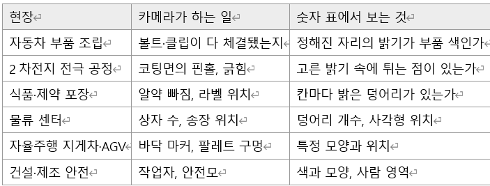

# Open CV 시작과 이미지 구조
# 0. 개요
## 카메라가 보는 세상은 숫자 표다
- 카메라가 컴퓨터한테 넘기는 것: 숫자 표
  - 컴퓨터는 시각이라는 개념이 없음
- 비전 프로그램이 하는 일: 숫자 표(넘파이 배열)에서 원하는 숫자를 골라 비교
  - 그래서 우리가 넘파이와 판다스를 배웠었음

#### OpenCV가 하는 일

## 전체 흐름에서 지금 배우는 부분
- 카메라 검사 프로그램은 사진 한 장을 받아서 여러 단계를 차례로 거친 뒤 "정상" 또는 "불량"이라는 결과를 도출

순서	|단계|하는 일
---|---|---
1|촬영|카메라에서 사진 한 장을 받는다
2|사진 이해하기 (이번 교안)|사진이 몇 칸짜리 숫자 표인지, 각 칸에 어떤 숫자가 들어 있는지 확인한다
3|사진 다듬기|흑백으로 바꾸고 자잘한 잡티를 지운다
4|찾고 세고 재기|물체를 찾아 몇 개인지, 얼마나 큰지 잰다
5|판정과 기록 (저장은 이번 교안)|정상·불량을 정하고, 결과 사진을 파일로 남긴다
## 준비
```bash
pip install opencv-python numpy
```

```python
import cv2
import numpy as np

print("OpenCV", cv2.__version__)   # 예: OpenCV 4.12.0 (설치 시기에 따라 다름)
print("NumPy", np.__version__)     # 예: NumPy 2.3.4 (설치 시기에 따라 다름)

```
```
OpenCV 5.1.0
NumPy 2.5.5
```

- 문제 2. 사진을 밝게 하는 함수 brighten(img, amount)를 만든다. 255를 넘어도 값이 돌아가지 않아야 한다.