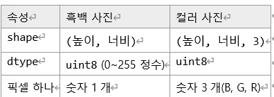
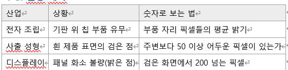
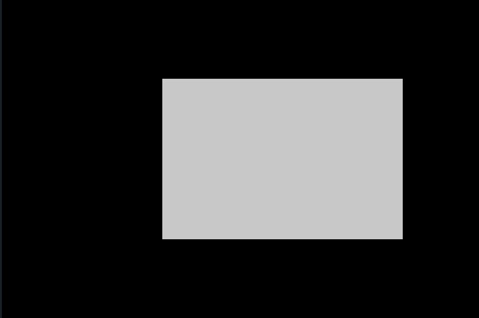
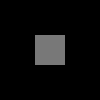

# 1. 이미지는 숫자 배열이다
## 개념
- 흑백 사진: 2차원 배열
    - 칸 하나가 픽셀
    - 값은 0~255 사이의 정수값
    - 값이 높을수록 밝음(0: 검은색, 255: 흰색)

- 컬러 사진: 3차원 배열
    - 컬러 사진은 B(Blue), G(Green), R(Red) 세 가지 채널로 구성
    - 즉, 컬러 사진은 가로, 세로, 색상 이렇게 3개의 차원을 가짐

## 왜 필요한가?
- 검사 기준은 결국 숫자
    - 딥러닝 모델도 입력은 숫자 배열 -> 모델에 넣기 전 크기 자료형 맞춰야 함

## 현장 예시


## 예제: 숫자로 만든 사진
```py
# code/section1_Image/s1_1_numpy_image.py
import numpy as np

img = np.zeros((4, 6), dtype=np.uint8) # 높이 4, 너비 6, 모두 검정
img[1:3, 2:5] = 200  # 가운데에 밝은 부품
print(img)

print("모양:", img.shape, " 자료형:", img.dtype)
print("부품 자리 평균 밝기:", img[1:3, 2:5].mean(), 
      " 전체 평균:", round(img.mean(), 1))
```
```
[[  0   0   0   0   0   0]
 [  0   0 200 200 200   0]
 [  0   0 200 200 200   0]
 [  0   0   0   0   0   0]]
모양: (4, 6)  자료형: uint8
부품 자리 평균 밝기: 200.0  전체 평균: 50.0
```

### 사진으로 출력해보면
```py
# code/section1_Image/s1_1_numpy_image.py
import cv2

'''...(중략)...'''

cv2.imshow('img', img)
cv2.imwrite('./Day8/code/data/s1_1.png', img)
cv2.waitKey()
cv2.destroyAllWindows()
```
> code/data/s1_1.jpg(확대해서 찍은 사진)
>
> 

## 오버플로우/언더플로우
### 오버플로우
- uint8은 0~255 값만 담음
- OpenCV에서 255를 초과한 값을 넘으면 0부터 다시 계산함
    - 예: 260의 값을 주면 4가 됨
        - 256 -> 0

```py
import cv2
import numpy as np


a = np.array([[250, 100]], dtype=np.uint8)
b = np.array([[10, 10]], dtype=np.uint8)

print("NumPy +   :", a + b)                  # 넘치면 돌아감
print("cv2.add   :", cv2.add(a, b))          # 255에서 멈춤
# NumPy +   : [[  4 110]]
# cv2.add   : [[255 110]]
```
```
NumPy +   : [[  4 110]]
cv2.add   : [[255 110]]
```
### 언더플로우
- 값이 0보다 작아지는 경우에는 마찬가지로 255부터 다시 시작함
```py
import cv2
import numpy as np

a = np.array([[250, 200, 10]], dtype=np.uint8)

print("더하기 10  NumPy:", a + 10, " cv2.add:", cv2.add(a, 10))
print("더하기 100 NumPy:", a + 100, " cv2.add:", cv2.add(a, 100))
print("빼기 20    NumPy:", a - 20, " cv2.subtract:", cv2.subtract(a, 20))
# 더하기 10  NumPy: [[  4 210  20]]  cv2.add: [[255 210  20]]
# 더하기 100 NumPy: [[ 94  44 110]]  cv2.add: [[255 255 110]]
# 빼기 20    NumPy: [[230 180 246]]  cv2.subtract: [[230 180   0]]

```
```
더하기 10  NumPy: [[  4 210  20]]  cv2.add: [[255 210  20]]
더하기 100 NumPy: [[ 94  44 110]]  cv2.add: [[255 255 110]]
빼기 20    NumPy: [[230 180 246]]  cv2.subtract: [[230 180   0]]
```


## 연습문제
- 문제 1. 100×100 검은 사진 가운데에 30×30 크기의 회색(밝기 120) 부품을 만들고, 부품 자리 평균 밝기와 전체 평균 밝기를 출력한다.

```py
import numpy as np

# 100x100 검은 사진
img = np.zeros((100, 100), dtype=np.uint8)

# 사진 가운데 120 밝기
img[35:65, 35:65] = 120
print('부품 자리 평균:', img[35:65, 35:65].mean())
print('전체 평균:', img.mean())

# 추가: 사진 출력해보기
import cv2

cv2.imshow('img', img)
cv2.imwrite('./Day8/code/data/s1_4_img.png', img)
cv2.waitKey()
cv2.destroyAllWindows()
```
> code/data/s1_4_img.png(원본 크기)
> 
> 

## 현장에서 주의할 점
- img[x, y]처럼 순서를 바꿔 써도 범위 안이면 오류 없이 엉뚱한 픽셀을 읽는다. 값이 이상하면 순서부터 확인한다.
- 로봇이나 PLC에 좌표를 넘길 때는 "원점이 어디고 y가 어느 쪽으로 커지는가"를 문서로 맞춘다.
