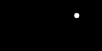

# 2. 해상도와 좌표
## 개념
- 해상도: 사진의 픽셀 수
- 좌표: 왼쪽 위가 (0, 0)
    - x는 오른쪽, y는 아래로 커짐
    - OpenCV 그리기 함수는 (x, y)(가로 먼저)를 씀

## 필요한 이유
- 해상도는 "찾을 수 있는 가장 작은 결함"과 "처리 속도"를 함께 정한다. 
    - 결함이 2~3픽셀 이상으로 찍혀야 안정적으로 잡히고, 해상도를 두 배로 올리면 픽셀 수는 네 배가 되어 처리 시간도 비슷하게 늘어난다. 
    Jetson 같은 엣지 장치에서는 이 균형이 특히 중요하다.
- 좌표계는 로봇·장치와 위치를 주고받을 때의 출발점이다. 
- 사진 좌표의 y가 아래로 커진다는 것을 모르면 로봇이 위아래를 뒤집어 움직인다.

## 현장 예시


## 예제: 해상도와 결함 크기
```py
FOV_MM = 300            # 카메라 시야 가로(mm)
DEFECT_MM = 0.5         # 찾아야 하는 가장 작은 결함

for width_px in [640, 1280, 1920, 4096]:
    mm_per_px = FOV_MM / width_px
    print(f"가로 {width_px:4d}px: 1픽셀 {mm_per_px:.3f}mm, 결함은 {DEFECT_MM / mm_per_px:4.1f}픽셀로 찍힘")
# 가로  640px: 1픽셀 0.469mm, 결함은  1.1픽셀로 찍힘
# 가로 1280px: 1픽셀 0.234mm, 결함은  2.1픽셀로 찍힘
# 가로 1920px: 1픽셀 0.156mm, 결함은  3.2픽셀로 찍힘
# 가로 4096px: 1픽셀 0.073mm, 결함은  6.8픽셀로 찍힘
```
```
가로  640px: 1픽셀 0.469mm           결함은  1.1픽셀로 찍힘
가로 1280px: 1픽셀 0.234mm           결함은  2.1픽셀로 찍힘
가로 1920px: 1픽셀 0.156mm           결함은  3.2픽셀로 찍힘
가로 4096px: 1픽셀 0.073mm           결함은  6.8픽셀로 찍힘
```

## 예제: 좌표 순서
```py
import cv2
import numpy as np

img = np.zeros((100, 200), dtype=np.uint8)

cv2.circle(img, (150, 30), 5, 255, -1)       # 그리기는 (x, y) = 가로 150, 세로 30
print("img[30, 150] =", img[30, 150])         # 배열은 [y, x]
print("img[150, 30] -> 범위 밖이라 오류가 날 자리. 높이가", img.shape[0], "뿐이다")
# img[30, 150] = 255
# img[150, 30] -> 범위 밖이라 오류가 날 자리. 높이가 100 뿐이다

cv2.imshow('img', img)
cv2.imwrite('./data/s2_2_img.png', img)

cv2.waitKey()
cv2.destroyAllWindows()
```
```
img[30, 150] = 255
img[150, 30] -> 범위 밖이라 오류가 날 자리. 높이가 100 뿐이다
```
>