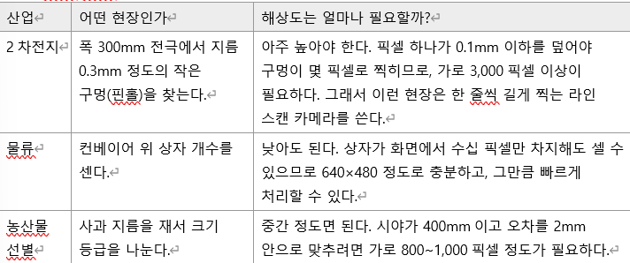

# 2. 해상도와 좌표
## 개념
- 해상도: 사진의 픽셀 수
- 좌표: 왼쪽 위가 (0, 0)
    - x는 오른쪽, y는 아래로 커짐
    - OpenCV 그리기 함수는 (x, y)(가로 먼저)를 씀

## 필요한 이유
- 해상도는 "찾을 수 있는 가장 작은 결함"과 "처리 속도"를 함께 정한다. 
    - 결함이 2~3픽셀 이상으로 찍혀야 안정적으로 잡히고, 해상도를 두 배로 올리면 픽셀 수는 네 배가 되어 처리 시간도 비슷하게 늘어난다. 
    Jetson 같은 엣지 장치에서는 이 균형이 특히 중요하다.
- 좌표계는 로봇·장치와 위치를 주고받을 때의 출발점이다. 
- 사진 좌표의 y가 아래로 커진다는 것을 모르면 로봇이 위아래를 뒤집어 움직인다.

## 현장 예시



## 예제: 해상도와 결함 크기
```py
FOV_MM = 300            # 카메라 시야 가로(mm)
DEFECT_MM = 0.5         # 찾아야 하는 가장 작은 결함

for width_px in [640, 1280, 1920, 4096]:
    mm_per_px = FOV_MM / width_px
    print(f"가로 {width_px:4d}px: 1픽셀 {mm_per_px:.3f}mm, 결함은 {DEFECT_MM / mm_per_px:4.1f}픽셀로 찍힘")
# 가로  640px: 1픽셀 0.469mm, 결함은  1.1픽셀로 찍힘
# 가로 1280px: 1픽셀 0.234mm, 결함은  2.1픽셀로 찍힘
# 가로 1920px: 1픽셀 0.156mm, 결함은  3.2픽셀로 찍힘
# 가로 4096px: 1픽셀 0.073mm, 결함은  6.8픽셀로 찍힘
```
```
가로  640px: 1픽셀 0.469mm           결함은  1.1픽셀로 찍힘
가로 1280px: 1픽셀 0.234mm           결함은  2.1픽셀로 찍힘
가로 1920px: 1픽셀 0.156mm           결함은  3.2픽셀로 찍힘
가로 4096px: 1픽셀 0.073mm           결함은  6.8픽셀로 찍힘
```

## 예제: 좌표 순서
- `cv2.circle(im, center, radius, color, thickness=-1, linetype=cv2.LINE_8, shift=0)`
    - img에 중심 위치 center(tuple)에 반지름 radius의 크기인 색깔 color(uint8(흑백))인 원을 그림
    - center은 튜플
    - color한테 int를 주면 흑백, (B, G, R) 형태의 튜플로 주면 컬러
    - thickness=-1을 주면 내부 채움
        - 기본값: 1

```py
import cv2
import numpy as np

img = np.zeros((100, 200), dtype=np.uint8)

cv2.circle(img, (150, 30), 5, 255, -1)       # 그리기는 (x, y) = 가로 150, 세로 30
print("img[30, 150] =", img[30, 150])         # 배열은 [y, x]
print("img[150, 30] -> 범위 밖이라 오류가 날 자리. 높이가", img.shape[0], "뿐이다")
# img[30, 150] = 255
# img[150, 30] -> 범위 밖이라 오류가 날 자리. 높이가 100 뿐이다

cv2.imshow('img', img)
cv2.imwrite('./data/s2_2_img.png', img)

cv2.waitKey()
cv2.destroyAllWindows()
```
```
img[30, 150] = 255
img[150, 30] -> 범위 밖이라 오류가 날 자리. 높이가 100 뿐이다
```
>

## 현장에서 주의 점
- img[x, y]처럼 순서를 바꿔 써도 범위 안이면 오류 없이 엉뚱한 픽셀을 읽는다. 값이 이상하면 순서부터 확인한다.
- 로봇이나 PLC에 좌표를 넘길 때는 "원점이 어디고 y가 어느 쪽으로 커지는가"를 문서로 맞춘다.

## 시야 좁히기
- 2-4 예제에서 카메라 시야(FOV_MM)를 300mm에서 100mm로 줄여 본다. 
- FOV는 Field of View의 줄임말로 카메라 한 장에 담기는 실제 폭이다. 
- 카메라를 물체에 더 가까이 대거나 확대 렌즈를 쓰면 시야가 좁아진다.
```py
FOV_MM = 100            # 시야를 300mm에서 100mm로 좁혔다
DEFECT_MM = 0.5

for width_px in [640, 1280, 1920]:
    mm_per_px = FOV_MM / width_px
    print(f"가로 {width_px:4d}px: 1픽셀 {mm_per_px:.3f}mm, 결함은 {DEFECT_MM / mm_per_px:4.1f}픽셀로 찍힘")
# 가로  640px: 1픽셀 0.156mm, 결함은  3.2픽셀로 찍힘
# 가로 1280px: 1픽셀 0.078mm, 결함은  6.4픽셀로 찍힘
# 가로 1920px: 1픽셀 0.052mm, 결함은  9.6픽셀로 찍힘
```
```
가로  640px: 1픽셀 0.156mm, 결함은  3.2픽셀로 찍힘
가로 1280px: 1픽셀 0.078mm, 결함은  6.4픽셀로 찍힘
가로 1920px: 1픽셀 0.052mm, 결함은  9.6픽셀로 찍힘
```
#### 확인할 것:
- 시야를 3분의 1로 좁히면, 같은 640px 카메라로도 결함이 1.1픽셀에서 3.2픽셀로 커진다. **비싼 카메라 대신 시야를 좁히는 것도 방법이다.**
- 대신 한 번에 보는 범위가 좁아지므로, 넓은 물체는 여러 번 나눠 찍거나 카메라를 여러 대 써야 한다.

#### 현장 이야기
- 로봇에게 물체 위치를 넘겼더니 로봇이 위아래를 반대로 움직였다. 
- 사진 좌표는 y가 아래로 커지는데 로봇은 y가 위로 커지는 좌표를 썼기 때문이다. 
- 넘기기 전에 y의 부호를 바꾸도록 고쳐 해결했다.
    - 로봇은 우리가 아는 일반적 좌표계를 사용

## 연습문제
문제 1. 시야가 200mm이고, 0.2mm 결함이 3픽셀 이상으로 찍혀야 한다. 카메라 가로 픽셀 수가 최소 얼마여야 하는지 계산한다.

```py
import math


fov_mm = 200
defect_mm = 0.2
pixel = 3

width = fov_mm / (defect_mm / pixel)
print('필요한 가로 픽셀 수:', width)
```
```
필요한 가로 픽셀 수: 3000.0
```

문제 2. 200×100 검은 사진의 x=40, y=70 자리에 흰 점을 찍고, 프로그램으로 그 점의 위치를 다시 찾아 x, y로 출력한다.
```py
import numpy as np

img = np.zeros((100, 200), dtype=np.uint8)
img[70, 40] = 255                                     # y=70, x=40 자리에 점
ys, xs = np.nonzero(img)                              # 결과는 (y 목록, x 목록) 순서
print("점의 위치 x =", xs[0], ", y =", ys[0])
# 점의 위치 x = 40 , y = 70

```
```
점의 위치 x = 40 , y = 70
```