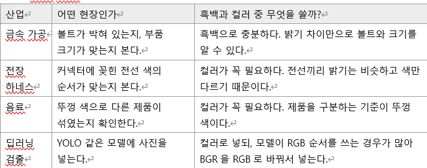
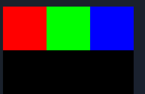
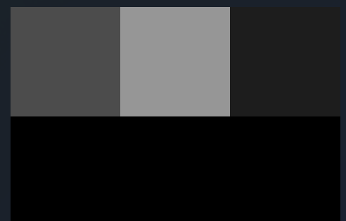
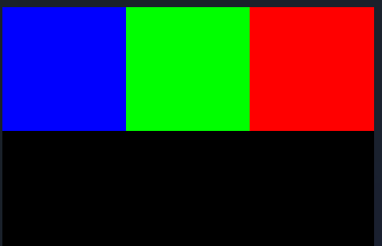
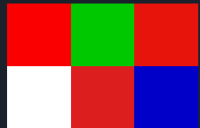

# 3. 컬러와 채널
## 개념
- 컬러 사진은 숫자 표 3장이 겹친 것
- OpenCV는 파랑, 초록, 빨강 순서로 저장
    - 타 프로그램에서 R, G, B 순으로 바꿔줄 것

## 필요한 이유
- 검사 대부분은 흑백으로 한다. 계산이 3분의 1이고, 밝기만으로 충분한 경우가 많기 때문이다. 
- 색이 판정 기준인 경우(배선 색, 캡 색, 신호등, 안전조끼)에만 컬러를 쓴다. 
- 채널 순서를 잘못 넘기면 딥러닝 모델이 빨간 제품을 파랗게 보고 인식률이 크게 떨어진다.

## 현장 예시


## 채널 나누기와 흑백 변환
```py
import cv2
import numpy as np

img = np.zeros((2, 3, 3), dtype=np.uint8)
img[0, 0] = (0, 0, 255)            # BGR 순서: 빨강
img[0, 1] = (0, 255, 0)            # 초록
img[0, 2] = (255, 0, 0)            # 파랑
b, g, r = cv2.split(img)
print("R 채널 첫 줄:", r[0])
gray = cv2.cvtColor(img, cv2.COLOR_BGR2GRAY)
print("흑백 첫 줄:", gray[0], "  ← 초록이 가장 밝게 바뀐다")
rgb = cv2.cvtColor(img, cv2.COLOR_BGR2RGB)
print("RGB로 바꾼 첫 픽셀:", rgb[0, 0])
# R 채널 첫 줄: [255   0   0]
# 흑백 첫 줄: [ 76 150  29]   ← 초록이 가장 밝게 바뀐다
# RGB로 바꾼 첫 픽셀: [255   0   0]
```
```
R 채널 첫 줄: [255   0   0]
흑백 첫 줄: [ 76 150  29]   ← 초록이 가장 밝게 바뀐다
RGB로 바꾼 첫 픽셀: [255   0   0]
```
> ./code/data/s3_1_1_img.png
>
> 
>
> ./codedata/s3_1_2_gray.png
> 
>
> 
> ./code/data/3_1_3_rgb.png
>
> 

## 여러 색을 흑백으로 만들기
```py
import cv2
import numpy as np

colors = {"빨강": (0, 0, 255), 
          "초록": (0, 255, 0), 
          "파랑": (255, 0, 0),
          "노랑": (0, 255, 255), 
          "흰색": (255, 255, 255), 
          "회색": (128, 128, 128)}


for name, bgr in colors.items():
    px = np.array([[bgr]], dtype=np.uint8)
    print(f"{name}: 흑백 밝기 {cv2.cvtColor(px, cv2.COLOR_BGR2GRAY)[0, 0]}")

```
```
빨강: 흑백 밝기 76
초록: 흑백 밝기 150
파랑: 흑백 밝기 29
노랑: 흑백 밝기 226
흰색: 흑백 밝기 255
회색: 흑백 밝기 128
```

#### 확인할 것:
- 노랑은 빨강과 초록이 섞인 색이라 흑백에서 아주 밝게(226) 나온다. 흰 배경 위 노란 라벨은 흑백으로는 잘 구분되지 않는다.
- 파랑은 29로 거의 검정에 가깝다. 검은 배경 위 파란 부품도 흑백에서는 잘 안 보인다. 이런 경우에는 컬러로 봐야 한다.

#### 현장 이야기: 
- 빨간 뚜껑을 찾도록 학습한 딥러닝 모델이 공장 카메라에서는 뚜껑을 거의 못 찾았다. 
- OpenCV로 읽은 BGR 사진을 RGB로 바꾸지 않고 그대로 넣어서, 모델 눈에는 빨간 뚜껑이 파랗게 보였기 때문이다. 
- 넣기 전에 cv2.cvtColor(img, cv2.COLOR_BGR2RGB)를 추가해 해결했다.

## 연습 문제
문제 1. 아래 2×3 컬러 사진에서 **"빨간 픽셀"(R이 200보다 크고 G와 B가 50보다 작은 픽셀)**이 몇 개인지 센다.
```py
import numpy as np

img = np.array([
    [(0, 0, 250), (0, 200, 0), (10, 20, 230)],
    [(255, 255, 255), (30, 30, 220), (200, 0, 0)]], 
    dtype=np.uint8)   # BGR

b, g, r = img[:, :, 0].astype(int),\
      img[:, :, 1].astype(int),\
          img[:, :, 2].astype(int)

red = (r > 200) & (g < 50) & (b < 50)
print("빨간 픽셀 수:", int(red.sum()), "/", red.size)
# 빨간 픽셀 수: 3 / 6

```
```
빨간 픽셀 수: 3 / 6
```

> 참고: 실제 사진 모습
> ./code/data/s3_3.png
> 

문제 2. **BGR을 RGB로 바꾸는 방법은 cv2.cvtColor 말고도 채널 순서를 거꾸로 하는 img[:, :, ::-1]가 있다.** 두 방법의 결과가 같은지 확인한다.
```py
import cv2
import numpy as np

rng = np.random.default_rng(0)
img = rng.integers(0, 256, (4, 5, 3), dtype=np.uint8)
a = cv2.cvtColor(img, cv2.COLOR_BGR2RGB)
b = img[:, :, ::-1]                                   # 채널 순서만 거꾸로
print("두 방법 결과가 같은가:", np.array_equal(a, b))
# 두 방법 결과가 같은가: True

```

```
두 방법 결과가 같은가: True
```