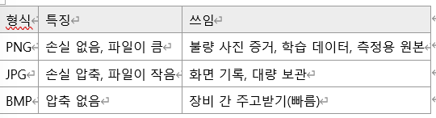
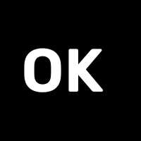
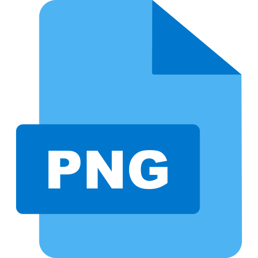
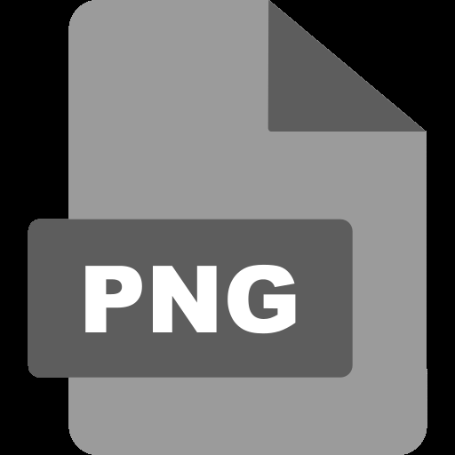

# 4. 읽기와 저장

## 개념


## 필요성
- 현장 프로그램은 판정 결과와 함께 사진을 남긴다. 불량이 왜 불량인지 나중에 확인하고, 고객에게 증거로 보내고, 오판정 사진을 모아 알고리즘이나 딥러닝 모델을 고치는 데 쓴다. 
- **측정과 학습에 쓸 사진을 JPG로 저장하면 압축 때문에 경계가 뭉개져 값이 달라질 수 있다.**

## 저장하고 다시 읽기
```py
import cv2
import numpy as np

img = np.zeros((100, 100), dtype=np.uint8)

# img 생성
cv2.putText(img, "OK", (15, 65), cv2.FONT_HERSHEY_SIMPLEX, 1.5, 255, 3)

# 저장
cv2.imwrite("./data/s4_1_1sample_png.png", img)
cv2.imwrite("./data/s4_1_2sample_jpg.jpg", img)

# 파일 읽기
png = cv2.imread("./data/s4_1_1sample_png.png", cv2.IMREAD_GRAYSCALE)
jpg = cv2.imread("./data/s4_1_2sample_jpg.jpg", cv2.IMREAD_GRAYSCALE)
print("PNG 원본과 다른 픽셀 수:", int((png != img).sum()))
print("JPG 원본과 다른 픽셀 수:", int((jpg != img).sum()))
print("없는 파일 읽기:", cv2.imread("no_such_file.png"))
# PNG 원본과 다른 픽셀 수: 0
# JPG 원본과 다른 픽셀 수: 963
# 없는 파일 읽기: None
```
```
PNG 원본과 다른 픽셀 수: 0
JPG 원본과 다른 픽셀 수: 981
[ WARN:0@0.023] global loadsave.cpp:279 findDecoder imread_('no_such_file.png'): can't open/read file: check file path/integrity
없는 파일 읽기: None
```
> jpg 파일
>
> 
> 
> png 파일
>
> 

## 주의할 점
- imread는 파일이 없거나 경로가 틀려도 오류를 내지 않고 None을 돌려준다. 다음 줄에서 엉뚱한 오류가 난다. 읽은 뒤 None인지 꼭 확인한다.
- Windows에서 경로에 한글이 있으면 imread/imwrite가 실패할 수 있다. 작업 폴더를 영문으로 두는 것이 가장 간단하다. 
    - 한글 경로를 꼭 써야 하면 cv2.imdecode(np.fromfile(경로, np.uint8), cv2.IMREAD_COLOR)로 읽는다.

## jpg 품질 바꿔보기
```py
import os
import cv2
import numpy as np

img = np.zeros((200, 200), dtype=np.uint8)
cv2.putText(
    img, "OK", (30, 130), 
    cv2.FONT_HERSHEY_SIMPLEX, 
    3, 255, 6)


for q in [50, 95, 100]:
    cv2.imwrite(f"./data/q{q}.jpg", img, [cv2.IMWRITE_JPEG_QUALITY, q])
    back = cv2.imread(f"./data/q{q}.jpg", cv2.IMREAD_GRAYSCALE)
    print(f"품질 {q:3d}: 파일 {os.path.getsize(f'./data/q{q}.jpg'):5d}바이트, 원본과 다른 픽셀 {int((back != img).sum())}개")
cv2.imwrite("./data/q.png", img)
print(f"PNG    : 파일 {os.path.getsize('./data/q.png'):5d}바이트, 원본과 다른 픽셀 0개")
# 품질  50: 파일  2183바이트, 원본과 다른 픽셀 2806개
# 품질  95: 파일  4497바이트, 원본과 다른 픽셀 2023개
# 품질 100: 파일  6325바이트, 원본과 다른 픽셀 201개
# PNG    : 파일  2225바이트, 원본과 다른 픽셀 0개
```
```
품질  50: 파일  2205바이트, 원본과 다른 픽셀 2897개
품질  95: 파일  4568바이트, 원본과 다른 픽셀 2031개
품질 100: 파일  6393바이트, 원본과 다른 픽셀 268개
PNG    : 파일  2219바이트, 원본과 다른 픽셀 0개
```
>각각 q50, q95, q100, q.png
> 


#### 확인할 것:
- **JPG는 품질 100으로 저장해도 원본과 똑같지 않다.** 측정이나 학습에 쓸 사진은 PNG로 저장한다.
- 이 예제처럼 단순한 사진은 PNG가 오히려 JPG보다 작을 수도 있다.
    - **실제 카메라 사진은 보통 PNG가 훨씬 크다.** (숫자는 OpenCV 버전에 따라 조금 다를 수 있다.)

## 연습문제

문제 1. 사진을 흑백으로 읽는 함수 read_gray(path)를 만든다. 읽기에 실패하면 안내 문구를 출력하고 None을 돌려준다.
```py
import cv2

def read_gray(path):
    img = cv2.imread(path, cv2.IMREAD_GRAYSCALE)
    if img is None:
        print("읽기 실패:", path, "(경로나 파일 이름을 확인한다)")
    return img

img = read_gray("./png_any.png")
print("결과:", img)

cv2.imwrite('./png_gray.png', img)

# 읽기 실패: no_such_file.png (경로나 파일 이름을 확인한다)
# 결과: None
```
```
결과: [[0 0 0 ... 0 0 0]
 [0 0 0 ... 0 0 0]
 [0 0 0 ... 0 0 0]
 ...
 [0 0 0 ... 0 0 0]
 [0 0 0 ... 0 0 0]
 [0 0 0 ... 0 0 0]]
```
> 원본 파일:  
>변환된 파일:   

문제 2. 판정 결과, 시각, 일련번호로 파일 이름을 만드는 함수를 만든다. 

예: NG_20261122_140509_007.png
```py
from datetime import datetime

def result_name(result, when, number):
    return f"{result}_{when:%Y%m%d_%H%M%S}_{number:03d}.png"

t = datetime(2026, 11, 22, 14, 5, 9)
print(result_name("NG", t, 7))
print(result_name("OK", t, 12))
# NG_20261122_140509_007.png
# OK_20261122_140509_012.png
```