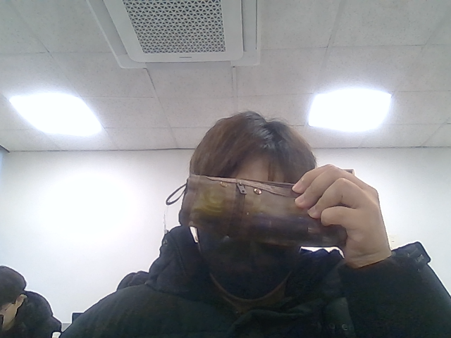

# 웹캠 사진 한 장 찍어 숫자로 보기
```py
import cv2

# 카메라 활성화
cap = cv2.VideoCapture(0)
ok, frame = cap.read() if cap.isOpened() else (False, None)
cap.release()

if not ok:
    print("카메라를 열 수 없다. 번호를 1로 바꿔 보거나 연결을 확인한다.")

else:
    gray = cv2.cvtColor(frame, cv2.COLOR_BGR2GRAY)
    h, w = gray.shape
    print("컬러 모양:", frame.shape, " 흑백 모양:", gray.shape)
    print("가운데 픽셀 BGR:", frame[h // 2, w // 2], " 흑백:", gray[h // 2, w // 2])
    print("평균 밝기:", round(float(gray.mean()), 1))
    cv2.imwrite("webcam_shot.png", frame)
    print("저장: webcam_shot.png")

```

```
(손가락 x)
컬러 모양: (480, 640, 3)  흑백 모양: (480, 640)
가운데 픽셀 BGR: [ 95 107 124]  흑백: 111
평균 밝기: 151.5
저장: webcam_shot.png
```

```
(손가락 o)
컬러 모양: (480, 640, 3)  흑백 모양: (480, 640)
가운데 픽셀 BGR: [ 3  9 63]  흑백: 24
평균 밝기: 16.1
저장: webcam_shot.png
```