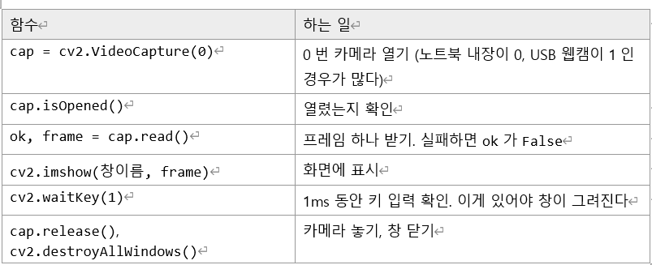

# 프레임 반복구조
## 개념


- 카메라 번호는 컴퓨터 연결된 순서로 0부터 시작

## 예제: 기본 반복문
```py
import cv2


'''카메라 준비'''
cap = cv2.VideoCapture(0)
if not cap.isOpened():
    print("카메라를 열 수 없다. 번호를 1로 바꿔 보거나 연결을 확인한다.")
    raise SystemExit

frames = 0

'''카메라로 영상 읽어들이기'''
while True:
    ok, frame = cap.read()
    if not ok:                                     # 케이블 빠짐, 카메라 오류
        print("프레임을 읽지 못했다.")
        break


    '''검사처리 부분'''
    gray = cv2.cvtColor(frame, cv2.COLOR_BGR2GRAY)  # ← 이 자리에 검사 처리가 들어간다
    cv2.imshow("camera", frame)
    frames += 1
    if cv2.waitKey(1) & 0xFF == ord("q"):
        break

print("처리한 프레임:", frames, " 마지막 평균 밝기:", round(float(gray.mean()), 1) if frames else None)


'''창 닫기'''
cap.release()
cv2.destroyAllWindows()

```
```
처리한 프레임: 76  마지막 평균 밝기: 0.0
```

## 주의할 점
- ok를 확인하지 않으면 카메라가 빠진 순간 frame이 None이 되어 다음 줄에서 프로그램이 죽는다.
- release()를 하지 않고 비정상 종료하면 카메라가 "사용 중"으로 남아 다른 프로그램이 못 여는 경우가 있다.
- 카메라를 막 열면 처음 몇 장은 자동 노출이 자리 잡는 중이라 어둡다. 판정은 처음 10장쯤 버린 뒤 시작한다.

## 처음 몇 장을 버리는 이유
- 카메라는 켜지자마자 밝기 맞추는 중이라 처음 몇 장이 어두움
    - 유효한 프레임부터 저장할 목적

```py
import numpy as np

frames = [
    np.full((120, 160), 
    200 * (1 - np.exp(-i / 4)), 
    dtype=np.uint8) for i in range(30)
]   # 켜자마자 서서히 밝아지는 카메라

levels = [float(f.mean()) for f in frames]

for skip in [0, 5, 10]:
    used = levels[skip:]
    print(f"처음 {skip:2d}장 버림: 사용한 프레임 밝기 최소 {min(used):5.1f}, 최대 {max(used):5.1f}")

```
```
처음  0장 버림: 사용한 프레임 밝기 최소   0.0, 최대 199.0
처음  5장 버림: 사용한 프레임 밝기 최소 142.0, 최대 199.0
처음 10장 버림: 사용한 프레임 밝기 최소 183.0, 최대 199.0
```
- 하나도 안버리면 완전 검은 프레임(밝기 0)까지 판정에 쓰임

## 연습 문제
문제 1. 프레임 10장 중 두 장을 읽기에 실패했다(None). 실패한 프레임은 건너뛰고, 성공한 프레임의 평균 밝기와 실패 횟수를 출력한다.
```py
import numpy as np

rng = np.random.default_rng(0)
frames = [rng.integers(90, 110, (60, 80), dtype=np.uint8) for _ in range(10)]
frames[3] = None                                  # 케이블이 잠깐 흔들려 읽기 실패
frames[7] = None

levels, fails = [], 0
for frame in frames:
    if frame is None:
        fails += 1
        continue                                  # 실패한 프레임은 건너뛴다
    levels.append(frame.mean())
print(f"성공 {len(levels)}장, 실패 {fails}장, 평균 밝기 {np.mean(levels):.1f}")
# 성공 8장, 실패 2장, 평균 밝기 99.5

```
```
성공 8장, 실패 2장, 평균 밝기 99.5
```

문제 2. 30fps 카메라에서 90장을 받는다고 할 때, 30장마다 한 번씩 "몇 초 지났는지"를 출력한다.
```py
for i in range(1, 91):                            # 90장 = 30fps로 3초
    if i % 30 == 0:
        print(f"{i}번째 프레임: {i // 30}초 지남")

```
```
30번째 프레임: 1초 지남
60번째 프레임: 2초 지남
90번째 프레임: 3초 지남
```