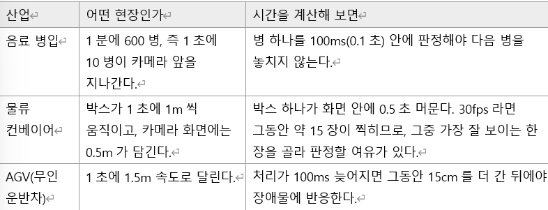

# 프레임률과 처리 시간
## 개념/필요성
- 프레임(FPS): 1초에 받는 프레임 수
    - 프레임이 30fps일 때, 33ms보다 오래 걸리면 처리 속도가 카메라를 못따라감

- 라인 속도와 프레임률·처리 시간이 맞지 않으면 제품을 놓친다. 
- 같은 코드도 노트북에서는 빠르고 Jetson 같은 엣지 장치에서는 느릴 수 있어서, 처리 시간을 재는 습관이 필요하다.

## 2-3. 현장 예시



## 처리 시간 예산 확인
```py
import time
import cv2
import numpy as np

'''30fps 카메라'''
FPS = 30
budget_ms = 1000 / FPS
rng = np.random.default_rng(0)


'''720x1280 화면'''
frame = rng.integers(0, 256, (720, 1280), dtype=np.uint8)


'''가우시안 블러로 약간의 지연 발생'''
for name, work in [
    ("블러 하나", lambda f: cv2.GaussianBlur(f, (5, 5), 0)),
    ("큰 블러 10번",\
      lambda f: [
          cv2.GaussianBlur(f, (31, 31), 0) for _ in range(10)]
    )]:
    t0 = time.perf_counter()
    work(frame)
    ms = (time.perf_counter() - t0) * 1000
    print(f"{name}: {ms:.1f}ms (예산 {budget_ms:.1f}ms) -> {'여유 있음' if ms < budget_ms else '카메라를 못 따라감'}")
# 예: 블러 하나: 2.1ms (예산 33.3ms) -> 여유 있음
# 예: 큰 블러 10번: 120.4ms (예산 33.3ms) -> 카메라를 못 따라감  (컴퓨터마다 다름)
```
```
블러 하나: 8.6ms (예산 33.3ms) -> 여유 있음
큰 블러 10번: 21.2ms (예산 33.3ms) -> 여유 있음
```

## 주의할 점
- 처리 시간은 평균만 보지 말고 가끔 튀는 최댓값도 본다. 가끔 한 번 늦어지는 순간에 제품을 놓친다.
- 처리가 느릴 때는 해상도를 줄이거나, 필요한 영역(ROI)만 처리하는 것이 가장 먼저 쓰는 방법이다.

## 라인이 빨라진다면...
```py
for per_min in [600, 1200, 3000]:
    per_sec = per_min / 60
    print(f"분당 {per_min:4d}병 = 초당 {per_sec:4.0f}병 -> 병 하나당 {1000 / per_sec:5.1f}ms 안에 판정")
# 분당  600병 = 초당   10병 -> 병 하나당 100.0ms 안에 판정
# 분당 1200병 = 초당   20병 -> 병 하나당  50.0ms 안에 판정
# 분당 3000병 = 초당   50병 -> 병 하나당  20.0ms 안에 판정
```
```
분당  600병 = 초당   10병 -> 병 하나당 100.0ms 안에 판정
분당 1200병 = 초당   20병 -> 병 하나당  50.0ms 안에 판정
분당 3000병 = 초당   50병 -> 병 하나당  20.0ms 안에 판정
```

#### 확인할 것
- 분당 3,000병이면 병 하나를 20ms 안에 끝내야 한다. 30fps 카메라의 프레임 간격(33ms)보다도 짧아서, 더 빠른 카메라가 필요하다.
- 2-4 예제를 자기 컴퓨터에서 돌려 보고, "블러 하나"가 몇 ms인지 적어 둔다. 같은 코드를 다른 컴퓨터에서 돌리면 숫자가 얼마나 달라지는지 옆 사람과 비교해 본다.
#### 현장 이야기
- 노트북에서 만든 검사 프로그램을 작은 엣지 장치에 옮겨 설치했더니 초당 30장이던 처리가 12장으로 떨어져 빠르게 지나가는 제품을 놓쳤다. 사진을 절반 크기로 줄이고 검사할 부분만 잘라 처리해서 다시 초당 30장을 맞추었다.

## 연습 문제
#### 문제 1. 물체 속도(mm/s), 화면에 담기는 폭(mm), 카메라 fps를 받아 "물체 하나가 몇 장 찍히는지" 계산하는 함수를 만든다.
```py
def frames_per_object(speed_mm_s, fov_mm, fps):
    stay_s = fov_mm / speed_mm_s                  # 물체가 화면 안에 머무는 시간
    return stay_s * fps

for speed, fov, fps in [(1000, 500, 30), (2000, 500, 30), (2000, 500, 10)]:
    print(f"속도 {speed}mm/s, 시야 {fov}mm, {fps}fps -> 물체 하나가 약 {frames_per_object(speed, fov, fps):.1f}장 찍힘")
# 속도 1000mm/s, 시야 500mm, 30fps -> 물체 하나가 약 15.0장 찍힘
# 속도 2000mm/s, 시야 500mm, 30fps -> 물체 하나가 약 7.5장 찍힘
# 속도 2000mm/s, 시야 500mm, 10fps -> 물체 하나가 약 2.5장 찍힘
```
```
속도 1000mm/s, 시야 500mm, 30fps -> 물체 하나가 약 15.0장 찍힘
속도 2000mm/s, 시야 500mm, 30fps -> 물체 하나가 약 7.5장 찍힘
속도 2000mm/s, 시야 500mm, 10fps -> 물체 하나가 약 2.5장 찍힘
```

#### 문제 2. 프레임 300장의 처리 시간 기록이 있다. 평균, 최댓값, 30fps 예산(33.3ms)을 넘은 횟수를 구한다.
```py
import numpy as np

rng = np.random.default_rng(1)
times = rng.normal(25, 4, 300)                    # 프레임 300장의 처리 시간(ms)
times[[50, 180, 260]] = [45, 52, 38]             # 가끔 튀는 프레임
budget = 1000 / 30
over = int((times > budget).sum())
print(f"평균 {times.mean():.1f}ms, 최대 {times.max():.1f}ms, 예산 {budget:.1f}ms 초과 {over}번")
# 평균 24.8ms, 최대 52.0ms, 예산 33.3ms 초과 7번
```
```
평균 24.8ms, 최대 52.0ms, 예산 33.3ms 초과 7번
```