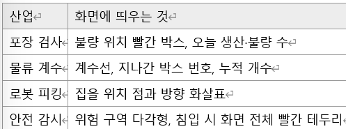
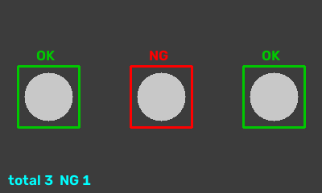
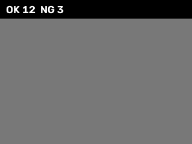

# 화면 표시와 결과 그리기

## 개념
- 판정 결과를 프레임 위에 그려 보여 준다. 사각형(cv2.rectangle), 원(cv2.circle), 글자(cv2.putText)를 쓴다. 색은 BGR 순서다.

## 현장 예시


## 결과_화면_만들기
```py
import cv2
import numpy as np

frame = np.full((240, 400, 3), 60, dtype=np.uint8)

parts = [((60, 120), True), ((200, 120), False), ((340, 120), True)]     # (위치, 정상 여부)
for (x, y), ok in parts:
    cv2.circle(frame, (x, y), 30, (200, 200, 200), -1)
    color = (0, 200, 0) if ok else (0, 0, 255)
    cv2.rectangle(frame, (x - 38, y - 38), (x + 38, y + 38), color, 2)
    cv2.putText(frame, "OK" if ok else "NG", (x - 15, y - 45), cv2.FONT_HERSHEY_SIMPLEX, 0.6, color, 2)

ng = sum(1 for _, ok in parts if not ok)
cv2.putText(frame, f"total {len(parts)}  NG {ng}", (10, 230), cv2.FONT_HERSHEY_SIMPLEX, 0.6, (255, 255, 0), 2)
cv2.imwrite("result_view.png", frame)
print("저장: result_view.png, 불량", ng, "개 표시")
# 저장: result_view.png, 불량 1 개 표시
```
```
저장: result_view.png, 불량 1 개 표시
```


## 주의할 점
- 원본 프레임에 바로 그리면 그 프레임은 더 이상 판정에 쓸 수 없다(글자가 결함처럼 보임). 판정은 원본으로, 그리기는 frame.copy()에 한다.
- cv2.putText는 한글을 그리지 못한다(물음표로 나옴). 화면 글자는 영문·숫자로 쓴다.

## 원본에 그리면 생기는 일
- 4-4 예제의 parts에서 True와 False를 바꿔 보고, 글자 크기(0.6)와 색을 바꿔 결과 사진을 열어 본다. 그다음 아래 코드로 "원본에 바로 그리면 왜 안 되는지" 확인한다.
```py
import cv2
import numpy as np

frame = np.full((240, 400, 3), 60, dtype=np.uint8)
cv2.circle(frame, (200, 120), 30, (200, 200, 200), -1)
before = frame[90:150, 170:230].mean()

cv2.putText(frame, "NG", (185, 125), cv2.FONT_HERSHEY_SIMPLEX, 0.6, (0, 0, 255), 2)   # 원본에 바로 그림
after = frame[90:150, 170:230].mean()
print(f"부품 자리 평균 밝기: 그리기 전 {before:.1f}, 원본에 그린 뒤 {after:.1f}")
# 부품 자리 평균 밝기: 그리기 전 169.6, 원본에 그린 뒤 164.7

```
```
부품 자리 평균 밝기: 그리기 전 169.6, 원본에 그린 뒤 164.6
```
#### frame의 변화


## 연습문제
문제 1. 프레임 위쪽에 검은 띠를 깔고 "OK 개수 NG 개수"를 흰 글자로 쓰는 함수 draw_status를 만든다. 원본은 바꾸지 않아야 한다.
```py
import cv2
import numpy as np

def draw_status(frame, ok_count, ng_count):
    view = frame.copy()
    cv2.rectangle(view, (0, 0), (view.shape[1], 30), (0, 0, 0), -1)        # 위쪽 검은 띠
    cv2.putText(view, f"OK {ok_count}  NG {ng_count}", (10, 22), cv2.FONT_HERSHEY_SIMPLEX, 0.6, (255, 255, 255), 2)
    return view

frame = np.full((240, 320, 3), 120, dtype=np.uint8)
view = draw_status(frame, 12, 3)
print("띠 자리 픽셀  원본:", frame[5, 300].tolist(), " 표시 화면:", view[5, 300].tolist())
# 띠 자리 픽셀  원본: [120, 120, 120]  표시 화면: [0, 0, 0]
```
> origin
>
> 
>
> view
> 
> 

문제 2. 불량이면 화면 가장자리에 두꺼운 빨간 테두리를 그리는 함수 alarm_border를 만든다. 멀리서도 작업자가 불량을 알아채게 하는 표시다.
```py
import cv2
import numpy as np

def alarm_border(frame, is_ng, thickness=10):
    view = frame.copy()
    if is_ng:
        h, w = view.shape[:2]
        cv2.rectangle(view, (0, 0), (w - 1, h - 1), (0, 0, 255), thickness)
    return view

frame = np.full((240, 320, 3), 120, dtype=np.uint8)
print("정상일 때 모서리:", alarm_border(frame, False)[2, 2].tolist())
print("불량일 때 모서리:", alarm_border(frame, True)[2, 2].tolist())
# 정상일 때 모서리: [120, 120, 120]
# 불량일 때 모서리: [0, 0, 255]

cv2.imwrite('4_5_1_pass.png', alarm_border(frame, False))
cv2.imwrite('4_5_2_fail.png', alarm_border(frame, True))

```
```
정상일 때 모서리: [120, 120, 120]
불량일 때 모서리: [0, 0, 255]
```

