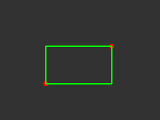
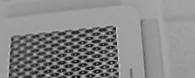

# 키와 마우스 입력
## 개념
- cv2.waitKey(): 누른 키 번호 돌려줌
- cv2.setMouseCallback(창 이름, 함수): 창에서 마우스 누르면 그 함수 불림

## 필요성
- 현장 프로그램에는 작업자가 하는 조작이 있다. 기준 제품을 놓고 "기준 등록", 검사 영역을 마우스로 지정하는 "교시(티칭)", 문제가 있는 장면 "수동 저장", "일시 정지" 같은 것들이다. 처음에는 키 몇 개와 마우스로 간단하게 만든다.

## 마우스로 점 찍기
```py
import cv2
import numpy as np

points = []

def on_mouse(event, x, y, flags, param):
    if event == cv2.EVENT_LBUTTONDOWN:          # 왼쪽 버튼을 누른 순간
        points.append((x, y))


img = np.full((240, 320, 3), 50, dtype=np.uint8)
cv2.namedWindow("click")

# 마우스 클릭 상호작용
cv2.setMouseCallback("click", on_mouse)

while True:
    view = img.copy()
    for p in points:
        # 클릭하면 점 그림
        cv2.circle(view, p, 5, (0, 0, 255), -1)

    # 점 2개 클릭하면 사각형 그려줌
    if len(points) >= 2:
        cv2.rectangle(view, points[0], points[1], (0, 255, 0), 2)
    cv2.imshow("click", view)
    key = cv2.waitKey(20) & 0xFF

    # c키 누르면 그림 초기화
    if key == ord("c"):
        points.clear()

    # q 누르면 끝
    elif key == ord("q"):
        break

cv2.imwrite('s5_1.png', view)
cv2.destroyAllWindows()
print("찍은 점:", points[:2], "-> 이 두 점이 검사 영역의 모서리가 된다")
```
```
찍은 점: [(223, 92), (91, 167)] -> 이 두 점이 검사 영역의 모서리가 된다
```


## 연습문제
문제 1. 마우스로 찍은 두 점을 받아 검사 영역 (x, y, 너비, 높이)를 돌려주는 함수 to_roi를 만든다. 어느 점을 먼저 찍어도 같은 결과가 나와야 한다.
```py
'''
실시간 영상에서 마우스로 관심 영역(ROI)을 지정하는 프로그램

  마우스 좌클릭 2번 : 좌상단점 -> 우하단점 순서로 찍으면 ROI 지정, 평균 밝기 표시
  c : ROI를 지우고 다시 실시간 영상
  s : 사진 저장 (ROI가 있으면 ROI 부분도 따로 저장)
  q : 종료
'''
from datetime import datetime
from pathlib import Path

import cv2

USB_CAMERAS = [1, 2, 3, 4]                        # USB 카메라 후보 번호 (앞에서부터 시도)
WEBCAM = 0                                        # USB 카메라가 없을 때 쓸 노트북 웹캠
FREEZE_ON_ROI = False                             # True: ROI를 지정하면 c를 누를 때까지 화면 정지
SAVE_DIR = Path(__file__).resolve().parent / "data"
WINDOW = "roi"


def open_camera():
    '''USB 카메라를 먼저 찾고, 없으면 웹캠을 연다. 둘 다 없으면 (None, None)'''
    for idx in USB_CAMERAS + [WEBCAM]:
        cap = cv2.VideoCapture(idx, cv2.CAP_DSHOW)
        if cap.isOpened() and cap.read()[0]:      # 열리기만 하고 영상이 안 나오는 장치는 건너뛴다
            return cap, idx
        cap.release()
    return None, None


def make_roi(p1, p2):
    '''두 점을 (x, y, w, h)로 바꾼다. 거꾸로 찍어도 되고, 넓이가 없으면 None'''
    x1, x2 = sorted((p1[0], p2[0]))
    y1, y2 = sorted((p1[1], p2[1]))
    if x1 == x2 or y1 == y2:
        return None
    return x1, y1, x2 - x1, y2 - y1


def roi_mean(frame, roi):
    '''ROI의 평균 밝기 (0: 검정 ~ 255: 흰색)'''
    x, y, w, h = roi
    gray = cv2.cvtColor(frame[y:y + h, x:x + w], cv2.COLOR_BGR2GRAY)
    return float(gray.mean())


def on_mouse(event, x, y, flags, state):
    if event != cv2.EVENT_LBUTTONDOWN or state["roi"] is not None:
        return                                    # ROI가 이미 있으면 c로 지우기 전까지 클릭 무시

    if state["first"] is None:
        state["first"] = (x, y)
        print("좌상단점:", (x, y))
        return

    roi = make_roi(state["first"], (x, y))
    if roi is None:
        print("영역의 넓이가 없다. 우하단점을 다시 찍는다.")
        return
    state["roi"], state["first"] = roi, None
    print("우하단점:", (x, y), "-> ROI (x, y, w, h):", roi)


def draw_view(frame, state):
    '''원본은 그대로 두고 복사본에 그린다'''
    view = frame.copy()
    if state["roi"] is not None:
        x, y, w, h = state["roi"]
        cv2.rectangle(view, (x, y), (x + w, y + h), (0, 255, 0), 2)
        text = f"ROI x{x} y{y} w{w} h{h}  mean {roi_mean(frame, state['roi']):.1f}"   # 밝기는 원본에서 잰다
    elif state["first"] is not None:
        cv2.circle(view, state["first"], 5, (0, 0, 255), -1)
        text = "click bottom-right"
    else:
        text = "click top-left"
    cv2.putText(view, text, (10, 30), cv2.FONT_HERSHEY_SIMPLEX, 0.7, (0, 0, 255), 2)
    return view


def save_photo(frame, roi):
    '''박스와 글자가 없는 원본을 저장한다'''
    SAVE_DIR.mkdir(exist_ok=True)
    name = datetime.now().strftime("roi_%Y%m%d_%H%M%S_%f")[:-3]
    images = {f"{name}_frame.png": frame}
    if roi is not None:
        x, y, w, h = roi
        images[f"{name}_crop.png"] = frame[y:y + h, x:x + w]
    for file_name, image in images.items():
        path = SAVE_DIR / file_name
        print("저장:" if cv2.imwrite(str(path), image) else "저장 실패:", path)


def main():
    cap, idx = open_camera()
    if cap is None:
        print("카메라를 열 수 없다. 연결을 확인하거나 다른 프로그램이 쓰고 있는지 확인한다.")
        raise SystemExit
    print(f"{idx}번 카메라 사용 ({'웹캠' if idx == WEBCAM else 'USB 카메라'})")

    state = {"first": None, "roi": None}          # first: 먼저 찍은 점, roi: 확정된 영역
    cv2.namedWindow(WINDOW, cv2.WINDOW_AUTOSIZE)  # 창 크기 = 영상 크기라서 클릭 좌표가 곧 픽셀 좌표
    cv2.setMouseCallback(WINDOW, on_mouse, state)

    frame = None
    while True:
        if frame is None or not (FREEZE_ON_ROI and state["roi"] is not None):
            ok, frame = cap.read()
            if not ok:
                print("프레임을 읽지 못했다. 카메라 연결을 확인한다.")
                break

        cv2.imshow(WINDOW, draw_view(frame, state))
        key = cv2.waitKey(10) & 0xFF

        if key in (ord("c"), ord("C")):
            state["first"] = state["roi"] = None
            print("ROI 초기화")
        elif key in (ord("s"), ord("S")):
            save_photo(frame, state["roi"])
        elif key in (ord("q"), ord("Q")):
            break

        if cv2.getWindowProperty(WINDOW, cv2.WND_PROP_VISIBLE) < 1:   # 창의 X 버튼으로 닫은 경우
            break

    cap.release()
    cv2.destroyAllWindows()


if __name__ == "__main__":
    main()

```

