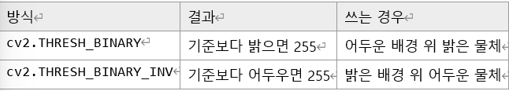
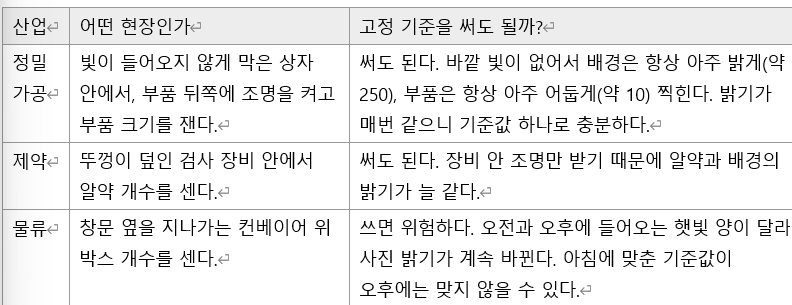
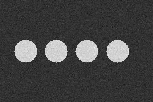
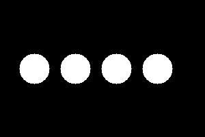

# 고정 기준 이진화
## 개념
- cv2.threshold(gray, 기준, 255, 방식): 기준보다 밝은 픽셀과 어두운 픽셀을 나눔



```py
import cv2
import numpy as np

pixels = np.array([[200, 50]], dtype=np.uint8)                        # 밝은 픽셀 하나, 어두운 픽셀 하나
_, b = cv2.threshold(pixels, 128, 255, cv2.THRESH_BINARY)
_, inv = cv2.threshold(pixels, 128, 255, cv2.THRESH_BINARY_INV)
print("원래:", pixels.tolist(), " BINARY:", b.tolist(), " BINARY_INV:", inv.tolist())
# 원래: [[200, 50]]  BINARY: [[255, 0]]  BINARY_INV: [[0, 255]]


# 기준치 바꿔서
_, b = cv2.threshold(pixels, 230, 255, cv2.THRESH_BINARY)
_, inv = cv2.threshold(pixels, 230, 255, cv2.THRESH_BINARY_INV)
print("원래:", pixels.tolist(), " BINARY:", b.tolist(), " BINARY_INV:", inv.tolist())
```
```
원래: [[200, 50]]  BINARY: [[255, 0]]  BINARY_INV: [[0, 255]]
원래: [[200, 50]]  BINARY: [[0, 0]]  BINARY_INV: [[255, 255]]
```

## 필요 이유
- 실제 검사가 이루어지는 곳: 암실에서 조명 비춤
- 이런곳에서는 밝기 기준 이진화면 충분



## 예제: 어두운 트레이 위 알약 세기
```py
import cv2
import numpy as np

rng = np.random.default_rng(0)
img = np.full((200, 300), 50, dtype=np.uint8)                       # 어두운 트레이
for cx in [50, 110, 170, 230]:
    cv2.circle(img, (cx, 100), 22, 210, -1)                         # 흰 알약 4개

# 정규분포 잡음 추가
img = np.clip(img + rng.normal(0, 8, img.shape), 0, 255).astype(np.uint8)


# 이진화
_, b = cv2.threshold(img, 128, 255, cv2.THRESH_BINARY)
n = cv2.connectedComponents(b)[0] - 1                               # 흰 덩어리 수 (0번은 배경)
print("알약 수:", n, " 흰 픽셀 비율:", round(cv2.countNonZero(b) / b.size, 3))

cv2.imwrite('1_2_1_image.png', img)
cv2.imwrite('1_2_2_.png', b)
```
```
알약 수: 4  흰 픽셀 비율: 0.101
```
- 원래 이미지
    
- 이진화 후 이미지
    

## 1-5. 현장에서 주의할 점
- 기준값은 물체와 배경 밝기의 대략 가운데로 잡는다. 둘 사이 간격이 넓을수록 조명이 조금 바뀌어도 버틴다.
- 결과가 "배경 전체가 하나의 물체"로 나오면 방식(BINARY / BINARY_INV)을 반대로 고른 것이다.

## 1-6. 따라 하기: 기준값을 바꿔 보기
- 1-4 예제에서 기준값 128을 60, 100, 180, 220으로 바꿔 가며 실행해 본다. 마지막으로 THRESH_BINARY를 THRESH_BINARY_INV로 바꿔 본다. 아래 코드는 그걸 한 번에 해 본 것이다.

## 문제 1
문제 1. 밝은 작업대(밝기 220) 위에 어두운 나사 머리(밝기 40) 5개가 있다. 고정 기준으로 나사 개수를 세 본다. 어느 방식을 써야 할까?

```py
import cv2
import numpy as np


# 이미지
rng = np.random.default_rng(5)
img = np.full((200, 400), 220, dtype=np.uint8)                       # 밝은 작업대
for cx in [40, 110, 180, 250, 320]:
    cv2.rectangle(img, (cx, 80), (cx + 40, 120), 40, -1)             # 어두운 나사 머리 5개
img = np.clip(img + rng.normal(0, 10, img.shape), 0, 255).astype(np.uint8)


# 130 기준으로 이진화
_, b = cv2.threshold(img, 130, 255, cv2.THRESH_BINARY_INV)          # 어두운 것이 흰색이 되도록
print("나사 수:", cv2.connectedComponents(b)[0] - 1)
# 나사 수: 5

```
## 문제 
2. 기준값을 눈대중으로 정하지 말고, "물체 한 곳의 평균 밝기"와 "배경 한 곳의 평균 밝기"의 가운데로 자동 계산하는 함수를 만든다. 1-4의 알약 사진에 적용해 본다.
```py
import cv2
import numpy as np


# 물체 한 곳의 평균 밝기를 구하는 함수
def middle_threshold(gray, obj_roi, bg_roi):
    # 두 사진의 가로, 세로, 너비, 높이
    (x1, y1, w1, h1), (x2, y2, w2, h2) = obj_roi, bg_roi
    # 물체의 평균 밝기
    obj = gray[y1:y1 + h1, x1:x1 + w1].mean()
    # 백그라운드 평균 밝기
    bg = gray[y2:y2 + h2, x2:x2 + w2].mean()
    # 두 밝기의 평균
    return (obj + bg) / 2

# 이미지
rng = np.random.default_rng(0)
img = np.full((200, 300), 50, dtype=np.uint8)
for cx in [50, 110, 170, 230]:
    cv2.circle(img, (cx, 100), 22, 210, -1)
img = np.clip(img + rng.normal(0, 8, img.shape), 0, 255).astype(np.uint8)


# 가운데와 왼쪽 빈 곳을 이진화
th = middle_threshold(img, (40, 90, 20, 20), (0, 0, 40, 40))       # 알약 한가운데, 왼쪽 위 빈 곳
_, b = cv2.threshold(img, th, 255, cv2.THRESH_BINARY)
print(f"기준값 {th:.0f}, 알약 수 {cv2.connectedComponents(b)[0] - 1}")
# 기준값 130, 알약 수 4

cv2.imwrite('1_5_1_img.jpg', img)
cv2.imwrite('1_5_2_bin.jpg',b)
```