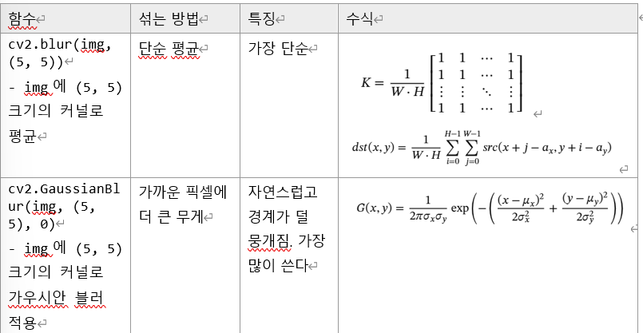
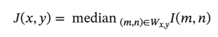
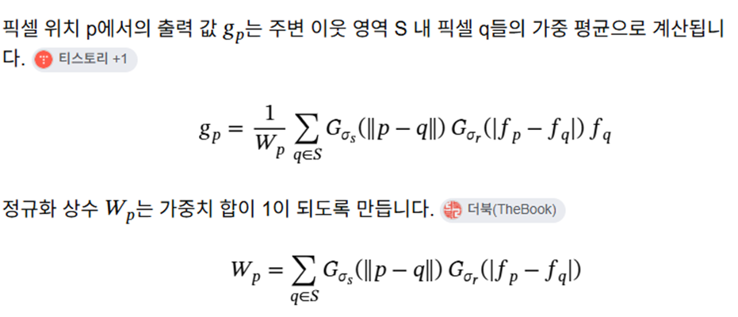
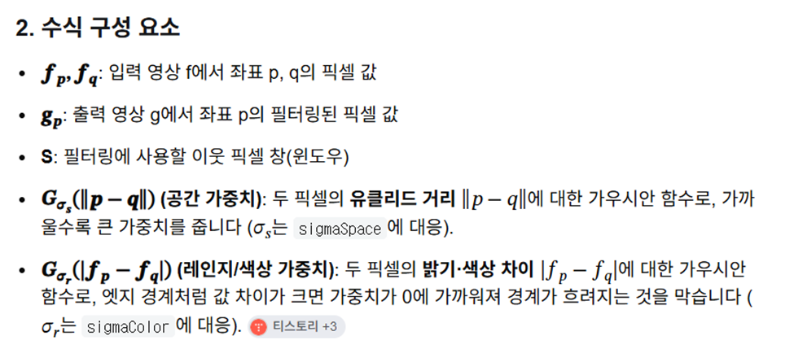

# 필터링
## 1. 블러링
- 블러: 픽셀 하나를 주변 픽셀들과 섞어(평균내어) 새 값으로 변경
    - 커널: 섞는 범위

## 2. 미디언
- 미디언 필터링: 주변 픽셀 값을 크기 순으로 줄 세운 뒤 가운데 값으로 변경

- 사용방법: `median_img = cv2.medianBlur(img, ksize=5)`
    - img에 커널(5, 5)별로 중앙값 산출해서 필터 적용
    - 커널 크기는 홀수 하나로 줄 것

## 3. 양방향 필터
- 양방향 필터: 섞을 때 "가까운 픽셀"이면서 "밝기도 비슷한 픽셀"

- 사용 방법: `dst = cv2.bilateralFilter(src, d, sigmaColor, sigmaSpace)`
    - src에 이웃 픽셀의 거리 d, 표준편차 sigmaColor만큼 양방향 필터 적용
    - sigmaSpace에 -1을 입력하면 자동 결정됨