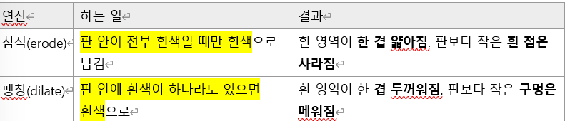

# 모폴로지
## 침식과 팽창
- 모폴로지: 작은 모양 판(구조 요소, 커널)을 흰 영역 가장자리를 따라 굴리며 깎거나 붙임

- `cv2.getStructuringElement(모양, (크기, 크기))`
- `cv2.MORPH_ELLIPSE`: 타원
- `cv2.MORPH_RECT`: 직사각형

- `cv2.erode(src, kernel, iterations=1)`: src에 kernel만큼 iteration 번 침식 반복

- 'cv2.dilate(src, kernal, iterations=1)`:
scr에 kernal만큼 iteration번 팽창 반복

## 열기: 잡점 지우기
- 열기: 침식한 뒤 같은 크기로 팽창 
    - 침식에서 사라진 작은 흰 점이 팽창애도 돌아오지 않고, 큰 물체는 원래 크기로 돌아옴
    - 잡점을 삭제할 때 사용

- `cv2.morphologyEx(b, cv2.MORPH_OPEN, k)`: 