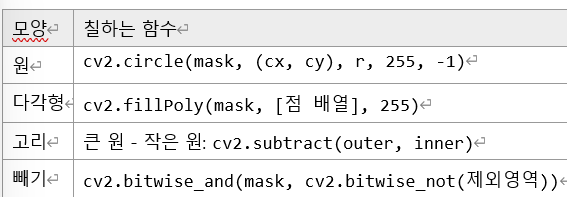

# ROI와 마스크
- ROI(관심 영역)과 마스크: 보통 카메라는 검사할 것보다 더 많이 촬영

## ROI 자르기
- x, y, w, h 네 숫자 사용
- img[y:y+h, x:x+w] 형식으로 슬라이싱해서 ROI 가져옴
- ROI 자를 때 원본을 copy해서 가져와야 함
    - 그냥 가져오면 원본도 잘림

- 사용 이유: 사진을 안자르고 그냥 가져오면 처리 시간 오래 걸림

## 마스크
- ROI는 사각형만 가능
    - 다른 모양으로 영역 지정하고 싶으면 마스크 사용

- 마스크는 0으로 채운 판에 볼 부분만 255로 칠함
- 마스크 안에서 계산: mask= 인자 사용
    - 예: `cv2.mean(gray, mask=m)[0]`
- 사용 이유: 둥근물체 사각형으로 ROI재면 모서리의 배경 섞임

## 영역 제한
- 색 마스크나 이진화 결과에 영역 마스크를 cv2.bitwise_and로 겹치면 "이 영역 안에서, 이 조건"만 남는다.
- 필요 없는 영역을 빼버릴 목적